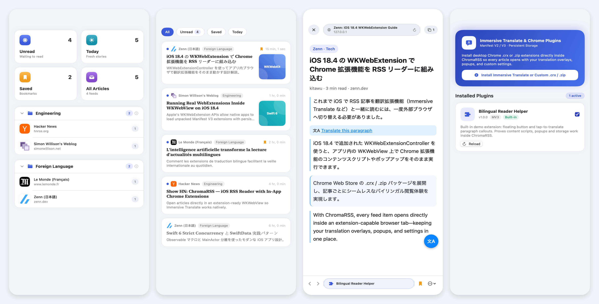
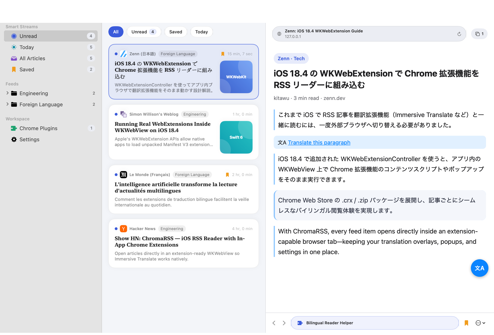
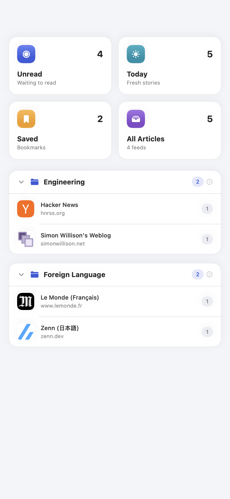
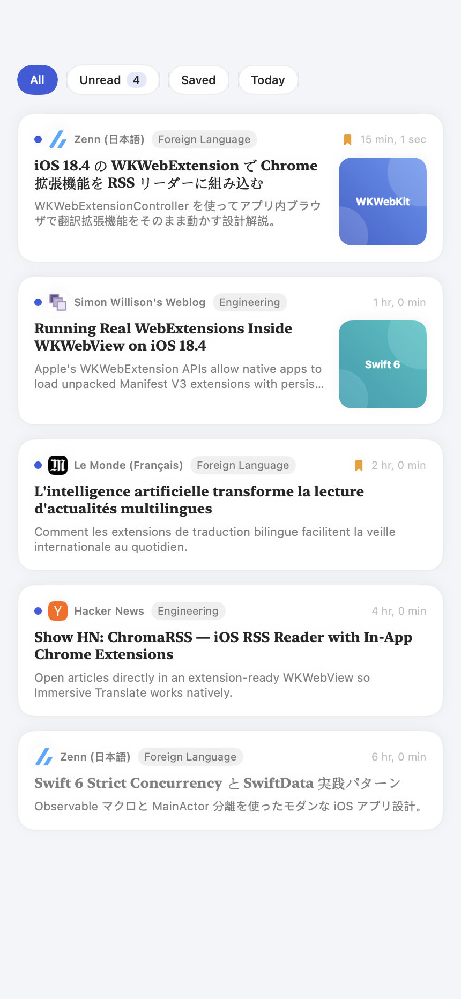
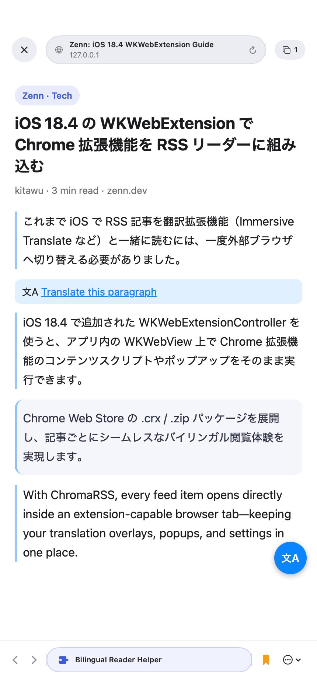
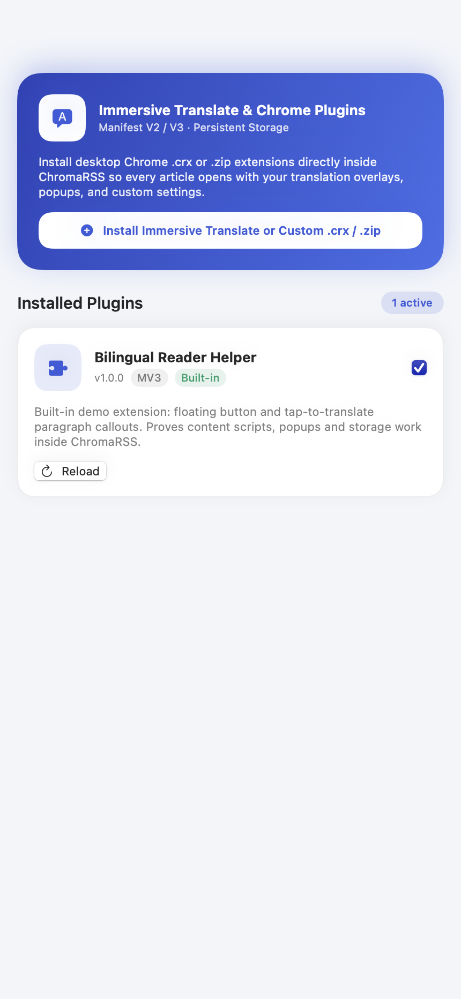

# ChromaRSS

A native **iOS 18.4+ & macOS 15.4+** RSS/Atom/JSON Feed subscriber with a built-in **`WKWebView` + `WKWebExtensionController`** in-app browser — so you can install and run real Chrome extensions (`.crx` / `.zip` Manifest V2 & V3, including **Immersive Translate**) directly on every article without leaving the app.





## Why ChromaRSS?

On iOS, standalone Google Chrome does not support desktop Chrome extensions, and `SFSafariViewController` does not expose Safari Web Extensions inside third-party apps. Starting in **iOS 18.4** (and macOS 15.4), Apple's WebKit added native `WKWebExtension` / `WKWebExtensionController` APIs. ChromaRSS pairs a local SwiftData RSS reader with an embedded multi-tab browser wired directly to `WKWebExtensionController`.

## Features

- **Local RSS, Atom, & JSON Feed Engine (`ChromaRSSCore`)**
  - Parses RSS 2.0, RSS 1.0 (RDF), Atom 1.0, and JSON Feed 1.1
  - Automatic feed discovery from website URLs (`<link rel="alternate">` + common feed endpoints)
  - OPML 2.0 import & export with folder organization
  - Starter feed presets (including Japanese & French feeds for testing translation plugins)
- **In-App Chrome-Extension Browser (`WKWebExtensionController`)**
  - Install Chrome extensions directly from a **Chrome Web Store URL / Extension ID**, a **direct `.crx`/`.zip` URL**, or **Files (`.zip` / `.crx`)**
  - Pure-Swift **CRX2/CRX3 unwrapper** + **Deflate/Stored ZIP extractor** with Zip-Slip path traversal protection and automatic `background.persistent` iOS compatibility patching
  - Persistent `chrome.storage` across launches via stable `WKWebExtensionContext.uniqueIdentifier`
  - Multi-tab support, extension toolbar icons & live badges, popup sheets/popovers, and extension options pages (`webkit-extension://`)
- **Built-in Starter Extension (`Bilingual Reader Helper`)**
  - Ships bundled inside `ChromaRSS.app` as a ready-to-test MV3 extension with a floating `文A` button, paragraph bilingual callouts, popup UI, and `chrome.storage.local` persistence

## Installing Immersive Translate

1. Open the **Extensions** tab in ChromaRSS and tap **Install Immersive Translate** (or `+`).
2. Choose **Fetch from Chrome Web Store** (preconfigured with Immersive Translate's ID `bpoadfkcbjbfhfodiogcnhhhpibjhbnh`), **or** tap **Download the `.zip` from GitHub Releases** and import the downloaded `immersive-translate-chrome-*.zip` via **Import `.zip` / `.crx` from Files…**.
3. Open any foreign-language article in **Feeds** — it launches directly inside the extension browser with Immersive Translate ready in the bottom toolbar.

## Architecture

```text
ChromaRSS/
├── Packages/ChromaRSSCore/       # Pure-Swift package (RSS/Atom/JSON parser, OPML, discovery, CRX2/3 + ZIP unpacker)
├── ChromaRSS/
│   ├── App/                      # App entry point, TabView, screenshot harness
│   ├── Models/                   # SwiftData Feed & Article models + AppSettings
│   ├── Services/                 # FeedSyncService, ExtensionManager (WKWebExtensionControllerDelegate), BrowserSession
│   ├── Views/                    # Feeds, Articles, Reader, Extension Browser, Extension Manager, Settings
│   └── BundledExtensions/        # Built-in MV3 Bilingual Reader Helper extension
└── scripts/generate_xcodeproj.py # Deterministic Xcode project generator
```

## Building & Running

### Requirements
- Xcode 16.3+ (iOS 18.4 SDK / macOS 15.4 SDK)
- An iPhone or iPad running **iOS 18.4+** (or an iOS 18.4+ Simulator runtime, or macOS 15.4+)

### Steps
1. Open `ChromaRSS.xcodeproj` in Xcode.
2. Select the **ChromaRSS** target → **Signing & Capabilities** → choose your Apple ID Development Team (for running on your iPhone/iPad).
3. Select your iPhone/iPad (iOS 18.4+) or Mac and press **Run (`Cmd+R`)**.

### Regenerating `.xcodeproj` & Running Core Unit Tests
```bash
# Run pure-Swift unit tests
cd Packages/ChromaRSSCore
DEVELOPER_DIR=/Applications/Xcode.app/Contents/Developer swift test

# Regenerate ChromaRSS.xcodeproj after adding/removing Swift files
python3 scripts/generate_xcodeproj.py
```

## Screenshots

| Library Bento | Magazine Stream | Extension Browser (`文A` Active) | Chrome Plugin Studio |
| :---: | :---: | :---: | :---: |
|  |  |  |  |
